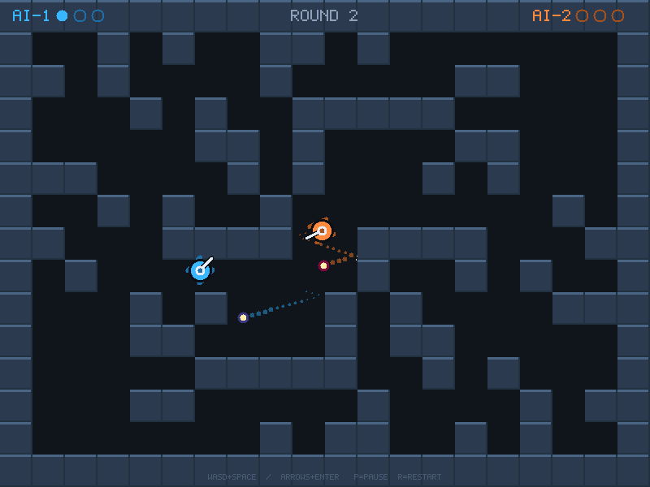

# 坦克动荡（Tank Trouble 复刻版）

> 《程序设计思想与方法（C++）》第一章作业 第五题（奖励题）项目
> 纯 C++17 + Xlib 实现，**零第三方依赖**（不需要 SDL/SFML/Qt），在 Linux 桌面上直接编译运行。



---

## 1. 它是什么

一个**双人对战 / 人机对战**的俯视角坦克射击小游戏，规则复刻经典 Flash 游戏 *Tank Trouble*：

- 迷宫式场地，两辆坦克在角落里出生；
- 坦克只能**转向 + 前进/后退**，炮弹沿车头方向射出；
- **炮弹会撞墙反弹**（默认最多 4 次），反弹后的炮弹依然可以打死人；
- **自己的炮弹也能打死自己**，所以乱开炮经常是自杀；
- 每辆坦克**同时最多在场 5 发炮弹**；
- 先赢 3 局者赢得比赛。

## 2. 编译与运行

```bash
sudo apt install g++ libx11-dev make      # 只需要这三样（绝大多数桌面发行版已自带）
# 在仓库根目录下：
make            # 生成可执行文件 ./tank
./tank          # 人机对战（默认）
```

常用命令行参数：

| 参数 | 作用 |
|---|---|
| `--mode 0/1/2` | 0 = 双人同屏，1 = 人机对战（默认），2 = 电脑互殴（演示） |
| `--level 1/2/3` | 电脑难度：简单 / 普通 / 困难 |
| `--wins N` | 先赢 N 局获胜（默认 3） |
| `--seed N` | 随机种子，同一种子生成同一张迷宫（可复现） |
| `--bounces N` | 炮弹最多反弹次数（默认 4） |
| `--cell N` / `--cols` / `--rows` | 迷宫格子尺寸与格数 |
| `--sound` | 打开 XBell 音效（开炮/爆炸提示音） |
| `--sim N` | 无窗口自动对局 N 秒，打印比分与统计（用来测试 AI） |
| `--shot <帧数> <文件.ppm>` | 无窗口跑固定帧数后截图（写作业文档用的自动截图） |

## 3. 操作

| | 前进 | 后退 | 左转 | 右转 | 开炮 |
|---|---|---|---|---|---|
| 玩家 1（蓝色） | `W` | `S` | `A` | `D` | `空格` |
| 玩家 2（橙色） | `↑` | `↓` | `←` | `→` | `回车` |

`P` 暂停 / 继续，`R` 重开一场，`ESC` 或关闭窗口退出。

## 4. 代码结构

```
tank-trouble/
├── Makefile
└── src/
    ├── canvas.hpp / canvas.cpp   X11 双缓冲画布 + 内置 5x7 点阵字体（绘制层）
    ├── game.hpp   / game.cpp     迷宫生成、物理、炮弹反弹、AI、渲染（游戏逻辑层）
    └── main.cpp                  窗口、固定步长主循环、键盘输入、命令行（应用层）
```

分层原则：`canvas` 只懂"怎么画"；`game` 只懂"游戏是什么、怎么变"；`main` 只懂"窗口、
输入、帧循环、命令行"。三者之间只通过窄接口耦合，因此游戏逻辑可以完全不依赖窗口
（`--sim` / `--shot` 就是这么做到无头运行的）。

## 5. 实现要点

- **固定步长物理**：逻辑固定 120 Hz，渲染默认 60 FPS 上限；两者解耦，所以游戏速度
  与电脑性能无关（高刷屏也不会让坦克跑得更快）。
- **双缓冲绘制**：全部画到后台 Pixmap，再用一次 `XCopyArea` 上屏，彻底消除闪烁。
- **内置点阵字体**：不依赖 X 服务器上装了什么字体，5x7 字形用字符串写成，整数倍放大。
- **子弹隧穿防护**：子弹每帧按 2.5 像素切分子步，避免高速穿过薄墙。
- **迷宫生成**：随机障碍 + **180° 旋转对称**（保证两方地形公平）+ **连通性拒绝采样**
  （BFS 检查出生点能到达所有空地），200 次仍不合格则退回空旷场地。
- **僵局处理（Sudden Death）**：一回合超过 40 秒就开始每 1.2 秒按对称拆掉两对内部墙，
  场地越来越开阔，保证回合**一定会结束**（这个机制是自动化测试跑出来的需求）。
- **电脑对手**：决策周期 + 比例控制转向 + 瞄准误差 + **预判式躲子弹** + **卡墙脱困**。
- **自动化测试**：`--sim` 可以无窗口跑完整场比赛并输出统计，`make` 后一条命令即可
  批量验证"AI 是否总能分出胜负"。

## 6. 用到的自动化测试

```bash
# AI vs AI 跑 24 场（3 个难度 × 8 个随机种子），确认每场都能正常结束
for lv in 1 2 3; do for s in $(seq 1 8); do ./tank --mode 2 --level $lv --seed $s --sim 300; done; done
```

实测：24 个用例全部在 300 秒内分出胜负，平均每回合 2.5 ~ 22 秒。

## 7. 截图

`shots/` 目录下的 PNG 由 `--shot` 自动生成（无需人工截屏）：

```bash
./tank --mode 2 --seed 4 --shot 6300 shots/action.ppm   # 对战中：炮弹飞行 + 拖尾
convert shots/action.ppm shots/action.png
```

## 8. 许可证

本项目采用 [MIT License](LICENSE)，Copyright © 2026
[Jason-Pu-Junhao](https://github.com/Jason-Pu-Junhao)。
